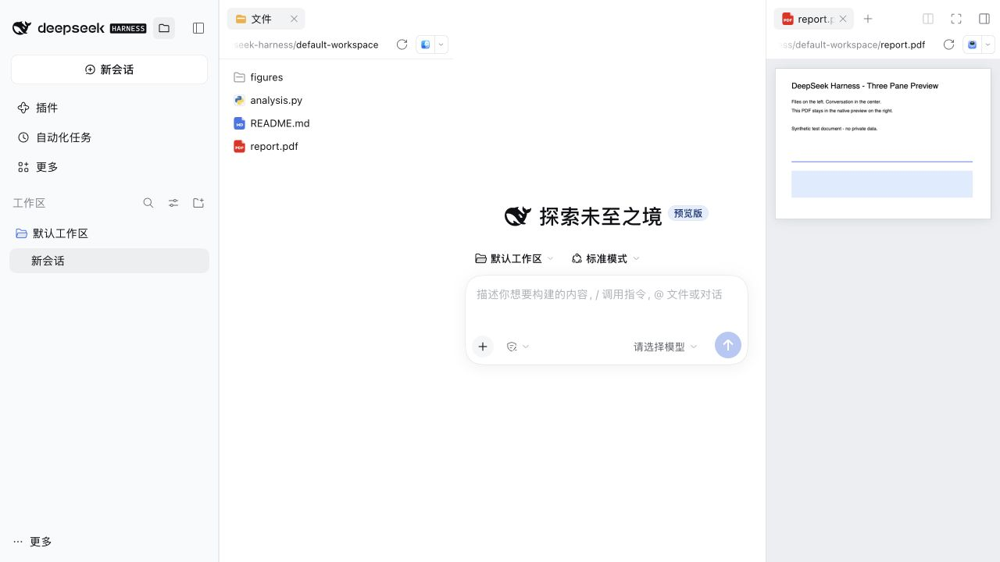
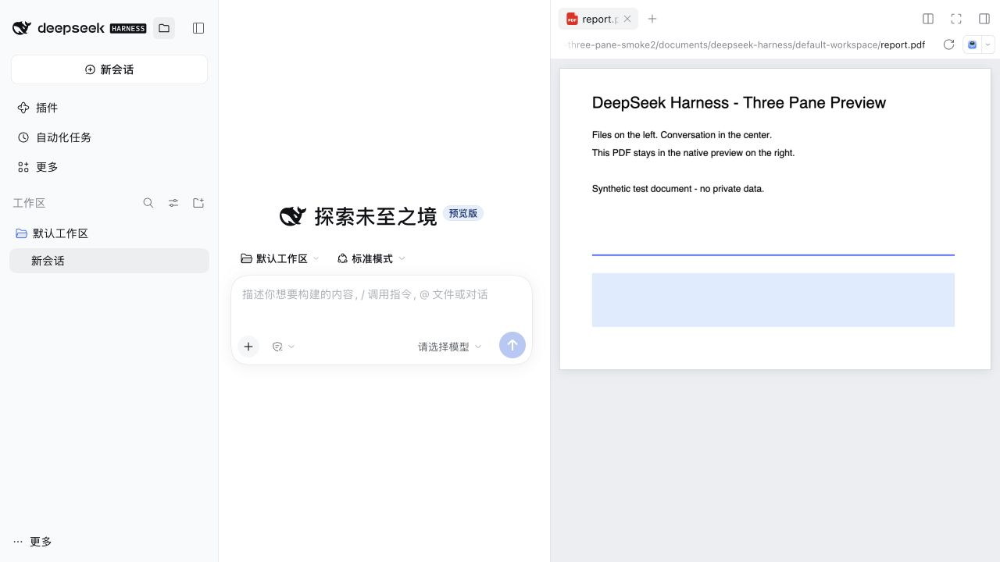

# dsh-three-pane

DeepSeek Harness 原生文件面板移位插件。将原本右侧的「文件」面板放到聊天左边，文件预览继续留在右边。

An independent native file explorer for DeepSeek Harness: files on the left, conversation in the center, and native previews in the right sidebar. A folder button beside the conversation-history toggle controls the explorer independently of both sidebars.

## 当前版本

当前版本：**0.5.1**。在 0.4.1 的文件栏操作基础上，重写远程 `@` 补全，并让对话中的文件卡片和右侧预览也能下载、引用和拖入聊天框。

文件页签、图标、路径栏、刷新按钮、打开方式和文件行全部使用 Harness 原生组件及其现有插件扩展。本插件只调整面板位置和宽度，不添加独立文件浏览界面。文件栏不再显示右侧侧栏的分栏、全屏和侧栏收缩按钮。





```text
展开时： [ 对话历史（可收起） ] [ 原生文件面板 ] [ 聊天 ] [ 原生文件预览 ]
收起后： [ 对话历史（可收起） ]                  [ 聊天 ] [ 原生文件预览 ]
```

## 安装

先下载 [预构建安装包](https://github.com/Wfssll/dsh-three-pane/releases/latest/download/dsh-three-pane.tgz)，或在 [版本页面](https://github.com/Wfssll/dsh-three-pane/releases/tag/v0.5.1) 下载固定版本。安装包包含已构建的客户端，无运行时 npm 依赖，不需要本地构建。

**官方 Desktop：** 打开「插件 → 添加插件 → 安装第三方插件」，输入下载的 `.tgz` 文件的完整本地路径，安装并按提示启用。`desktop` profile 在应用运行期间由桌面版专门管理，不能通过外部 CLI 修改。升级已有社区插件时，如宿主要求先卸载旧版，先在插件详情页卸载，再安装新包；不会删除聊天和工作区文件。

**Web profile：**

```bash
dsh plugin --profile web add https://github.com/Wfssll/dsh-three-pane/releases/download/v0.5.1/dsh-three-pane-0.5.1.tgz
```

将 `web` 换成自己的 profile 名称。安装后重新加载客户端，必要时重启该 profile。尚未发布到 npm，请使用 GitHub Release 安装包。

**Desktop (English):** Download the prebuilt `.tgz`, then open **Plugins → Add plugin → Install third-party plugin**, paste the full local archive path, install, and enable. For Web profiles, use the command above.

升级到 0.5.1 后，按窗口右上角的刷新按钮（它会替换宿主插件并重建界面）。如果刷新后页面仍加载旧客户端（桌面壳会为窗口冻结启动清单），请完全退出并重新打开 Harness；普通的页面重载只换界面，不会替换宿主插件或冻结清单。

## 使用

会话历史栏的收起按钮左侧新增文件夹图标，点击可独立展开、收起文件栏。历史栏收起后，文件夹按钮仍与「展开会话历史」「新建会话」两个原生按钮一起保留，顺序为「文件 → 会话历史 → 新建会话」。

文件栏和右侧侧栏各自管理开关，互不联动：收起预览不会收起文件，开关文件栏也不会开关预览。隐藏文件栏保留原生文件页签和目录展开状态；文件页签上的关闭按钮也只隐藏文件栏。

点击文件会在右侧原生侧栏预览。右侧侧栏保留原来的分栏、全屏和收起功能；文件栏顶部不再提供这些侧栏控件，也不再显示新建侧栏页签按钮。

文件栏右边缘可拖动调宽；聚焦分隔线后可用左右方向键调节，双击恢复 300px。文件栏始终占用独立列，右侧预览优先缩小以保留至少 400px 的聊天区域；极窄窗口可横向滚动，不覆盖聊天内容。

## 文件操作（0.4.0）

在文件栏中，所有工作区（本地和 SSH）行为一致：

- **拖到聊天框**：拖动任意文件或文件夹行到输入框，自动加入 `@相对路径` 引用，路径含空格时自动加引号。不再依赖仅对 SSH 工作区打过补丁的行为。
- **右键菜单**：下载（文件夹打包为 `.tar`）、引用到聊天、复制相对路径、重命名、删除、新建文件夹、上传文件、上传文件夹。在空白处右键可对工作区根目录上传或新建文件夹。
- **拖入上传**：把 Finder 里的文件或文件夹拖到文件树上，落在哪个文件夹行上就传到哪个文件夹；落在文件行上传到它所在的文件夹；落在空白处传到工作区根目录。同名文件不会被静默覆盖，会先询问。右下角卡片显示进度。

说明：

- 文件操作由插件的宿主部分完成（`/api/dsh-files/*`），每个请求绑定到会话的工作区根目录，越出根目录的路径和指向工作区外的符号链接会被拒绝。**安装或升级后需完全退出并重新启动 Harness。**
- SSH 工作区通过系统 `ssh` 命令执行（读取 `~/.dsh/ssh-workspace-anchors.json` 得到主机别名和远端路径），要求该别名可免交互登录（密钥或 ssh-agent）。下载和上传不限大小，直接流式传输。
- 删除不可撤销，会先弹出确认。下载优先使用系统“另存为”选择位置；不可用时回退为浏览器下载。
- 拖入上传时，宿主原有的“文件或图片拖动到此处即可添加”全屏遮罩不会在文件树上出现，松手后也会被正确关闭（0.4.0 中它可能一直卡住）。
- SSH 连接会复用 2 分钟（`~/.ssh/dsh-three-pane/`），批量上传、下载和 `@` 补全不再每次重新握手。
- 远程工作区输入 `@` 时，通过已连接的 SSH helper 直接列出当前文件夹，并按目录缓存；输入 `data/` 会立刻列出该子文件夹。全工作区索引在后台建立，不阻塞当前文件夹的结果，建好后打开的 `@` 菜单会自动刷新，不需要关闭重开。
- 受浏览器目录读取接口限制，拖入的空文件夹不会上传（任务卡片会提示数量）。

## 对话文件与预览（0.5.1）

- 对话中由 `present` 声明的文件卡片（PDF、PNG 等）：右键可下载、**加入对话**、复制路径；拖到输入框会像文件栏一样添加 `@` 引用。远程卡片即使只带远端绝对路径，也能正确下载和引用，不再报「路径不在当前工作区内」。
- 右侧文件预览：文件页签标题本身、标题旁的拖动柄、预览里的文件路径标签都可以拖动；拖到输入框即可引用当前文件。右键页签、拖动柄或路径标签同样可以下载、加入对话或复制路径。
- 这些操作适用于本地和 SSH 工作区。SSH 下小于 32 MB 的文件下载走宿主已有的文件系统服务，不新开 SSH 连接；更大的文件和文件夹仍使用流式 SSH 传输。

## 实现与兼容性

- 已在 DeepSeek Harness **`0.2.1-rc.3`** 的 Web 与官方 macOS Desktop 上验证。其他宿主版本未逐一实测。
- 复用原生 `rightbar.session` 注册的组件、Store、注入服务及子 Slot 授权。
- 只为渲染生成「文件」和「预览」布局视图；文件栏的可见状态由插件按会话独立管理，不跟随右侧侧栏的展开状态。目录仍使用原生文件页签，不复制文件数据。
- 文件列表和预览仍由宿主已有文件面板处理；下载、上传、重命名、删除由本插件的宿主部分完成。
- 原生组件装饰依赖当前版本的 Slot 注册结构；未来宿主升级后可能需要适配。
- 停用或卸载会恢复原生组件并移除自己的样式和布局留白。

## 开发

```bash
npm ci --ignore-scripts
npm run check
mkdir -p dist
npm pack --pack-destination dist
```

`src/client.js` 负责原生面板装饰、显示位置和 `@` 菜单刷新，`src/model.js` 负责布局投影与路径/引用辅助函数，`src/files.js` 是文件树、对话卡片和预览的拖拽与右键菜单，`src/index.js` + `src/fileops.js` 是宿主部分（HTTP 路由、本地/SSH 文件操作和快速引用），`src/style.css` 包含几何布局与界面样式。

验证：42 项自动检查通过，覆盖独立开关、预览状态保持、会话隔离、原生组件复用及卸载恢复，路径越界与符号链接拦截、同名不覆盖、上传/下载/重命名/删除（本地、以脚本模拟的 SSH、以及为 SSH 注入的宿主文件系统），远程 `@` 的目录缓存与后台索引，以及对话卡片和预览的右键、拖拽行为。0.3.0 另在真实宿主中验证过本地和 SSH 文件的 PDF 预览；0.4.0 的界面操作尚未在真实 Desktop 中逐项实测。上面的截图使用合成测试工作区，不含私人对话或研究数据。

## 卸载

Desktop 在「插件」页卸载 `dsh-three-pane`。Web 使用 `dsh plugin --profile web remove dsh-three-pane`。

## License

[MIT](LICENSE).
